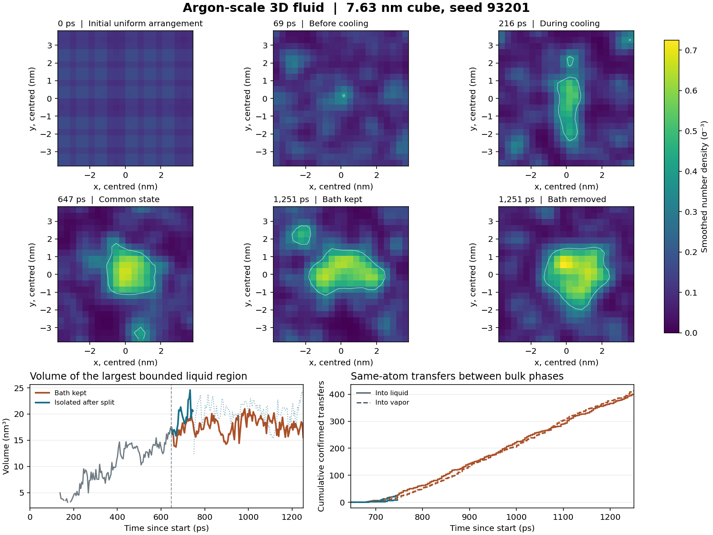
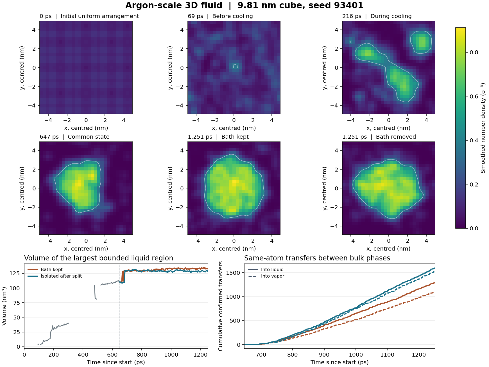

# 液滴の境界と原子の入れ替わりを同じ3D履歴で測る

2026-11-20。R4「膜：内と外」に向けた、単原子の二相界面による測定例。役割は F（持続と交換を同じ履歴で測る）、V（実測に基づく物性との照合、測定器と力の再検査）。計算から読んだ数は tier measured。二成分の選択的な透過や反応で支えられる維持は未測定で、はしご R4 は open。[現在の到達点](../../research/ladder.json)

## 与えた条件

アルゴンの再現に用いられてきた Lennard–Jones の物性尺度を使う。質量は \(m=39.948\) u、長さは \(\sigma=0.3405\) nm、対ポテンシャルの深さは \(\epsilon/k_B=119.8\) K。時間は \(\tau=\sigma\sqrt{m/\epsilon}=2.15635\) ps、数密度 \(1/\sigma^3\) に当たる質量密度は \(1680.32\ {\rm kg\,m^{-3}}\)。対相互作用 \(U(r)=4\epsilon[(\sigma/r)^{12}-(\sigma/r)^6]\) を、距離 \(r_c\) で値も力も連続にゼロになるよう線形力シフトした。\(r<r_c\) で \(U_{\rm fs}=U(r)-U(r_c)+(r-r_c)F(r_c)\)、\(F=-U'\)。\(r\geq r_c\) では相互作用はゼロ。今回の \(r_c=2.5\sigma\) と \(3.5\sigma\) は異なる対相互作用であり、遠距離補正は入れない。各対の力は逆向きで、孤立させた連続時間のモデルでは粒子数、運動量、運動と相互作用の和のエネルギーが保存する。[アルゴンの分子動力学の原典](https://doi.org/10.1103/PhysRev.136.A405)・[尺度の採用例](https://doi.org/10.1002/pssb.202000344)・[計算コード](../../research/campaigns/20261120-argon-interface-turnover/fluid.cpp)

時刻0に原子を希薄で一様な面心立方の配置に置き、温度 \(T^*=k_BT/\epsilon=1.5\) の速度を振り、最初の重心速度を引く。液滴の形、界面、内外を決める原子ラベルは入力していない。通常の箱は \(22.4\sigma\) 四方に1,372原子、拡大箱は \(28.8\sigma\) 四方に2,916原子。平均密度はどちらも \(0.1221/\sigma^3\)。周期境界なので、箱全体の物質量は一定である。粒子は velocity Verlet で進め、熱浴を使うときは各粒子の速度を確率 \(1-e^{-0.30\Delta t/\tau}\) で対象温度の分布から引き直す。浴が与えた符号付き仕事はその瞬間の運動エネルギーの差で記録する。浴は運動量も交換する。

冷却組は \(t=32\tau\) から浴温を \(T^*=0.8\)（95.84 K）に変更する。\(t=300\tau\) の位置と速度をまるごと複製し、浴を続けるか止めるかを比べる。そこから \(580\tau\) までが比較窓で、換算して604 ps。冷却前からすべて時刻0を含む。暖かい対照は \(T^*=1.5\) のまま。時間刻みは \(0.004\tau\) と \(0.002\tau\)。最初の14本は6組と暖対照2本。後から登録した14本は、3つの新しい seed と2種類の力の範囲の交差6組、長い範囲で箱を拡大した1組。力の範囲を変える比較では seed を共通にし、初期速度をそろえた。浴を外す腕の対応は各箱・各ポテンシャルの内部でのみ厳密である。[最初の計画](../../research/campaigns/20261120-argon-interface-turnover/PLAN.json)・[新しい seed の追試](../../research/campaigns/20261120-argon-range-confirmation/PLAN.json)

## 境界と交換の判定

保存するのは全原子の3Dの位置、全体の運動・相互作用エネルギー、浴との交換、温度・運動量。原子の番号は配列の順番だけで、式に入らない。全時刻を \(2\tau\) ごとに保存した。診断用の位置は箱の1/65,536ごとの区画の番号で、計算内部は倍精度。分岐時には位置と速度を別に倍精度で保存し、両腕でハッシュを照合する。

液相と蒸気相の観測には、約 \(\sigma\) 幅の立方区画と標準偏差 \(\sigma\) のガウス平滑化を使う。基準密度 \(0.35/\sigma^3\) 以上の領域を周期境界込みで連結し、最大成分が体積80 \(\sigma^3\) 以上かつ3軸に空いた断面を持つとき、箱を一周していない液滴候補とした。隣り合う観測の最大成分の重なりを、共通部分を和集合で割る Jaccard 指標で読み、0.5未満か候補が消えた時点で追跡を打ち切る。途切れた区間を後からつながない。複数の成分は第2成分の大きさも保存する。この手順は密度境界の同一性の操作的測定で、連続時間の形や界面の全トポロジーを確定しない。

液側の奥は最大成分の表面を離散的な半径 \(2\sigma\) で削った内部。蒸気側の奥はどの濃い成分からもその離隔を持つ領域。原子がそれぞれの奥に3コマ連続していることを確認し、同じ番号を逆側で確認したものを数える。両端の実際の位置が最短周期距離でも \(2\sigma\) 以上違う件数も記録する。同じ原子の往復を含み、件数を独立な試行数にしない。境界の動きだけの影響を読むため、分岐時に全原子の座標を固定したまま、実際の動く境界で判定し直す。この固定座標は計算に入れない。位置の分離が浅い例、閾値0.30と0.40、奥を3 \(\sigma\) にした例、4 \(\tau\) 間隔の観測もそれぞれ記録した。[測定のコード](../../research/campaigns/20261120-argon-interface-turnover/analyze.py)

## 最初の14履歴

暖対照2本では候補体積の境界は全コマで0件だった。基本格子の3組では、観測する境界を最後まで連続して追えたのは浴あり2/3、浴なし1/3。主条件の成否は以下の通り。追跡の終了時刻は、その後の液滴の消滅を意味しない。例えば種93201の浴なしは346で途切れた後にも濃い領域が見える。

| 条件 | 浴ありで最後に追えた時刻（\(\tau\)） | 浴なしで最後に追えた時刻（\(\tau\)） |
| --- | ---: | ---: |
| 基本 93201 | 580 | 346 |
| 基本 93207 | 580 | 580 |
| 基本 93213 | 308 | 300 |
| 93201 時間刻み半分 | 470 | 304 |
| 93201 箱を拡大 | 306 | 310 |
| 93201 引力の範囲を \(3.5\sigma\) へ | 580 | 580 |

基本93207の孤立した枝で、最初に液の奥と確認できた80原子のうち79個を、いったん液から離れて蒸気の奥に入ったところまで追えた。最後に液の奥にいた90原子のうち32個は、開始時に蒸気の奥にいた。元の原子が何個か戻るので、79個という数は末尾で恒久的に入れ替わった割合を意味しない。奥から奥へ移動した件数は液へ938・蒸気へ922。座標を固定すると、移動距離を条件に入れる前の数は液へ52・蒸気へ251だった。基本93207の孤立枝は、密度を上下した2条件、深い奥、4 \(\tau\) 間隔でも終点まで追跡できた。初めに液にいたものが蒸気に移った割合は、判定によって分母が異なる。たとえば深く測ると4個中4個になる。全窓の外部の熱交換は厳密に0、エネルギーの最大変動は1原子当たり \(5.02\times10^{-5}\epsilon\)。[全履歴の結果](../../research/campaigns/20261120-argon-interface-turnover/analysis/results.json)



## 力の範囲を変えて追試した14履歴

新しい3種の初期速度を同じ順に使い、全履歴の力の範囲だけを変えた。液滴候補を最初に観測した時刻は短い範囲で92、84、62、長い範囲で50、50、54。先に候補が現れることと、比較窓の終点まで同じ境界を追えることは、以下のように異なる傾向を示した。

| 種・箱 | 短い範囲・浴あり | 短い範囲・浴なし | 長い範囲・浴あり | 長い範囲・浴なし |
| --- | ---: | ---: | ---: | ---: |
| 93401 基本箱 | 300 | 312 | 分岐時に候補なし | 分岐時に候補なし |
| 93407 基本箱 | 580 | 302 | 330 | 346 |
| 93413 基本箱 | 580 | 358 | 580 | 580 |
| 93401 拡大箱 | — | — | 580 | 580 |

表は追跡の最終時刻。種93401の基本箱の長い範囲では、分岐時に最大成分が箱をまたがないという条件を満たさず、比較窓を定義できなかった。同じ平均密度の拡大箱の孤立枝では、分岐時に液の奥だった634原子のうち353個を蒸気まで追え、終点で液の奥だった973原子のうち92個が分岐時に蒸気の奥にいた。2相の奥の間の実変位をともなう往来は液へ1,605・蒸気へ1,530回。座標固定の読み直しにも、変位の条件を入れる前は液へ132・蒸気へ1,134回の見かけの移動が出た。境界だけを見て蒸発の件数を数えると、大きくずれうる例である。[事前指定の基本箱の図](../../research/campaigns/20261120-argon-range-confirmation/analysis/no-bounded-at-fork.png)・[追試の全測定値](../../research/campaigns/20261120-argon-range-confirmation/analysis/results.json)

二つの計画を合わせて、孤立させた13枝中4本で主条件の境界を最後まで追跡できた。4本とも密度の上下、深い奥、粗い時刻、区画を使わない接触グラフで終点まで続き、実変位をともなう交換があった。同じ初期条件の刻み変更や箱変更を含むため、13を独立試行数とした確率にはしない。原子の出入りは閉じた箱の中の両相間であり、箱外との物質交換・代謝・化学的選択性を測るには異なる材料系が要る。[区画を使わなかった追試の読み直し](../../research/campaigns/20261120-argon-range-confirmation/analysis/contacts.json)



## 別の測定法と数値の照合

主結果を見た後、区画を使わずに同じデータを読む検査も行った。距離 \(1.8\sigma\) の近隣が8原子以上ある点を同じ距離でつなぐ。最大連結成分は48原子以上で、各軸の空いた区間が \(1.8\sigma\) より長いことを要求する。その中で近隣14以上を液側の奥、近隣4以下で濃い原子から \(2\sigma\) 以上離れているものを蒸気側の奥にする。最大成分の連続時刻の構成原子の Jaccard を使い、交換の持続時間と実変位の規則は同じ。基本93207の孤立枝はこの方法でも最後まで追え、液の奥にいた35原子中34個が蒸気の奥に達した。同じ条件の浴ありでは時刻302で連続追跡が切れた。測定法による不一致を全数残した。この読み直しは解析尺度の感度で、事前の確認試験とは区別する。[測定方法](../../research/campaigns/20261120-argon-interface-turnover/contact_check.py)・[全結果](../../research/campaigns/20261120-argon-interface-turnover/analysis/contacts.json)

合成入力で、周期境界をまたいだ有限の塊を一つにつなぎ、箱を一周する柱と一様場を除外した。1コマの飛び込みを交換に数えず、座標が固定なら移動距離の判定を通らない。実際の分岐の全1,372原子を使って、毎ステップ近隣を作り直す別実装で500ステップ再計算した。時刻302の全位置が保存区画内にあり、運動・相互作用エネルギーの差はそれぞれ \(3.5\times10^{-11}\epsilon\)、\(5.2\times10^{-11}\epsilon\) 以下だった。基本93207の組は全時間を同じ実行ファイルで最初から再計算し、全アーカイブと分岐ハッシュが一致した。コンパイラをまたぐ長時間のビット一致は調べていない。[独立再計算のコード](../../research/campaigns/20261120-argon-interface-turnover/validate.py)・[結果](../../research/campaigns/20261120-argon-interface-turnover/analysis/validation.json)

## 実物への照合

NIST のアルゴン参照値は、95.84 K の飽和液1,341.3 kg/m³、飽和蒸気12.239 kg/m³。実測資料に基づく状態方程式の値である。同じ法則の比較には、NIST の別手法の計算を使った。\(T^*=0.8\) で、短い力の範囲のバルク密度は液0.6521・蒸気0.05044、長い範囲では液0.7583・蒸気0.01284（単位 \(1/\sigma^3\)）。長い範囲のバルクでも、アルゴンの尺度に直すと蒸気は約21.58 kg/m³となる。ここにある実行はナノメートルの曲面を持つ滴であり、実物の平らな相平衡への照合で曲率を補正していない。[アルゴンの状態方程式](https://doi.org/10.1063/1.556037)・[短距離のバルク参照](https://www.nist.gov/mml/csd/chemical-informatics-group/sat-tmmc-liquid-vapor-coexistence-properties-linear-force-1)・[長距離のバルク参照](https://www.nist.gov/mml/csd/chemical-informatics-group/sat-tmmc-liquid-vapor-coexistence-properties-linear-force-0)

後半の浴あり基本93207は液1,127.0 kg/m³、蒸気108.2 kg/m³。長い範囲を使った93201は液1,286.6 kg/m³、蒸気31.76 kg/m³。同じ方法で追試の長い範囲の終点まで追えた2本を読むと液1,283.7〜1,287.3、蒸気29.09〜32.79 kg/m³。長い範囲を使ったこの3本の液は実物の参照から約4%低く、蒸気は約2.4〜2.7倍。曲率・箱のサイズ・古典的な対ポテンシャルの近似が残る。ナノ液滴の交換速度の実物での値は未検証である。

## 再現

**no-touch と第8監査。** 既存のモデル、公式 Room、過去の測定と物理履歴は保存した。与えたものは相互作用、箱、均一な初期の配置と速度、浴、冷却・停止時刻。液滴の形、選択的透過、交換の成功や持続時間を更新則に書かず、密度・追跡器は計算から独立させた。研究の根拠は固定した計画と生データに結ぶ。いずれの履歴にも箱外との物質の出入りはない。

リポジトリ直下、Python、NumPy 1.26.4、SciPy 1.15.3、C++17。図には matplotlib を使う。登録コミットを含む Git 履歴が必要。計算機により数分以上かかる。ソルバーは保存前の倍精度の位置で力を計算する。台帳には各ファイルの SHA-256 があり、以下のコマンドは ZIP 全体と個別ファイルを照合する。[全生データの研究リリース](https://github.com/sunpotflower4460-cpu/Aeterna-Genesis/releases/tag/research-20261120-argon-turnover)

```sh
base=research/campaigns/20261120-argon-interface-turnover
ranges=research/campaigns/20261120-argon-range-confirmation
export PYTHONPATH=.
export OMP_NUM_THREADS=1 OPENBLAS_NUM_THREADS=1
work=$(mktemp -d)
python "$base/fetch_evidence.py" --campaign "$base" --out "$work/base-data"
python "$base/fetch_evidence.py" --campaign "$ranges" --out "$work/range-data"
python "$base/analyze.py" --evidence "$work/base-data" --out "$work/base"
python "$ranges/study.py" analyze --evidence "$work/range-data" --out "$work/range"
python "$base/validate.py" --evidence "$work/base-data"
python "$base/contact_check.py" --plan "$ranges/PLAN.json" --evidence "$work/range-data" --out "$work/contacts.json"
python "$base/render.py" --plan "$ranges/PLAN.json" --evidence "$work/range-data" \
  --analysis "$work/range" --group large-35-93401

python "$base/run.py" --registered-at fd7d2dd2a7aa96a180d34784994b1192045f5a03 \
  --scratch "$work/scratch" --out "$work/replay"
python "$ranges/study.py" run --registered-at a4a2079675def6c599b2f028dd635b98ef2127e6 \
  --scratch "$work/range-scratch" --out "$work/range-replay"
```
