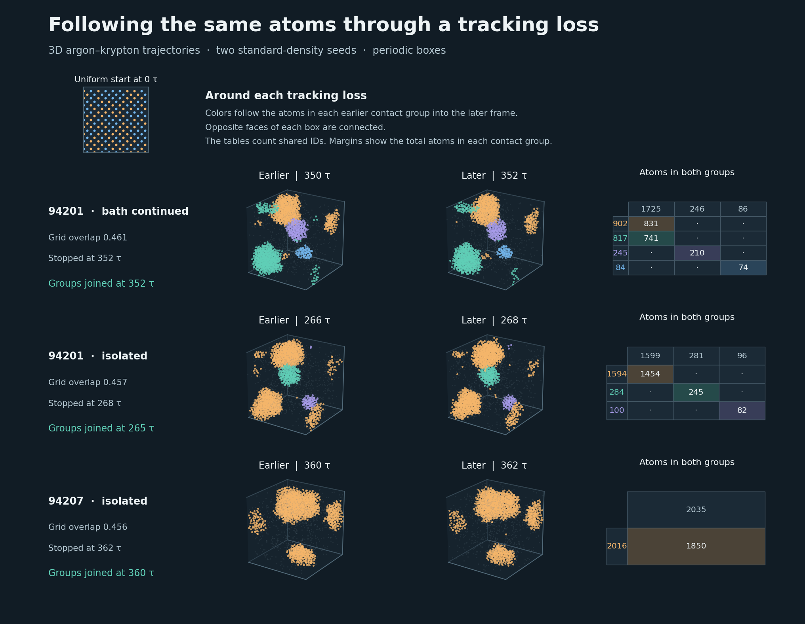

# 原子IDで追った3件の合流と追跡切れ

2026-11-20。前回の3D気液計算では、周期箱を一周しない濃い領域でも、隣の記録との形の重なりが0.5未満になると追跡を終えた。その3件を、全ての大きな粒子群の原子IDで読み直した。主条件では3件とも、それまで分かれていた二つの密な原子群がつながる過程を確認した。2件では、原子同士の接触でつながった時刻が、格子で追跡を終えた時刻より早かった。役割は V（追跡器の誤読と感度の検証）・F（有限時間の連結と原子IDの履歴）。数値は tier measured。[前回の25履歴と追跡切れ](2026-11-20-periodic-boundary-confirmation.md)

## 同じ履歴を細かく記録

前回 t=0 から計算した2種の大箱、各2,916原子を使った。位置は一様な面心立方格子、Ar と Kr の位置は無作為に混ぜて、Kr を約60%とした。古典的な3種の対力、温度の予定、時刻240τでの熱浴継続と孤立への分岐、積分刻み0.004τをそのまま用いた。座標と力学台帳の記録間隔を2τから0.5τ（約1.08 ps）にし、4本を時刻0から500τまで再実行した。対象は追跡が切れた3本と、同じ条件のもう一方の枝1本。実行と測り方の仕様を GitHub の `fbbfe7c2fb08b770e0794be74a4a2b4b4dc80295` に、観測コードを座標の取得・閲覧前に `e00306912c46f96b573acf6d9167ff01fed1a9ff` に固定した。前回の追跡不能の時刻は既知であり、新しい乱数種による検証ではない。[研究登録](../../research/campaigns/20261120-atom-contact-lineage/PLAN.json)・[固定した観測コードの範囲](../../research/campaigns/20261120-atom-contact-lineage/ANALYSIS_INPUTS.json)

各枝の共通251コマで、保存座標と全台帳列が一致した。初期位置・速度、原子種の配列、分岐時の倍精度位置・速度の SHA-256 も一致。各1,001コマの細かい方を、同じ履歴の追加観測として用いた。孤立2本は浴を外した後の熱交換が厳密に0、分岐後の全エネルギー変動は1原子当たり最大 $8.22\times10^{-5}\epsilon_{\rm Ar}$。異なるコンパイラで長時間のビット一致は調べていない。[照合値](../../research/campaigns/20261120-atom-contact-lineage/analysis/results.json)

## 観測

**密な原子群。** 周期境界で最短距離1.8σ以内の原子対を探し、近隣が8個以上ある原子同士をつなぐ。48原子以上の連結成分を全て記録し、種別を使わず原子数で順位を付ける。遠く離れたように見える点でも箱の反対面を介した接触を数える。一周するかは、接触を一つずつたどったときの箱をまたぐ整数変位の和から判定する。固定した閾値の判定には保存された16ビット座標の整数差を使った。大箱での1段は約 $4.39\times10^{-4}\sigma$。近隣数と半径に基づく液相粒子の同定には先行研究があり、今回の二成分・密な群に共通の1.8σと8近隣は過去のプロジェクトの読出しに合わせた値である。[近隣数を用いた液滴測定の一次研究](https://doi.org/10.1063/1.3279127)・[周期経路の計算原理](https://doi.org/10.1103/PhysRevE.64.016706)・[接触グラフ](../../research/campaigns/20261120-atom-contact-lineage/contact_graph.py)

**継続と合流。** 時刻の前後で、全ての群の組み合わせについて共通の原子IDを数える。継続には双方の原子の過半数が共通であることを要求する。合流は、親が2群以上、それぞれの自身の半数以上かつ子の20%以上を渡し、子に合わせて60%以上を供給する条件で記録した。各寄与24原子以上。分離は時刻を逆にした同じ条件。これらに関与する親子を一対一の継続から外す。格子の最大領域と接触群の対応にも双方過半数を求める。確認の持続条件は合流前の親と合流後の子がそれぞれ2τにわたって一対一で続くこと。[IDの移動と判定](../../research/campaigns/20261120-atom-contact-lineage/lineage.py)

## 追跡が切れた3件

表の接触時刻は観測済みの前後2コマで挟んだ区間。共有IDは直前の2群から直後の1群に入っていた数。時間の単位τは約2.156 ps。

| 履歴 | 格子で追跡を終了 | 接触で合流を観測 | 親2群の原子数 | 子の原子数 | 子にもいた親の原子数 | 主条件で前後各2τ持続 |
|---|---:|---|---:|---:|---:|---|
| 94201・浴継続 | 352τ | 351.5から352τ | 894と806 | 1,725 | 857と770 | 未成立 |
| 94201・孤立 | 268τ | 264.5から265τ | 818と772 | 1,597 | 778と731 | 成立 |
| 94207・孤立 | 362τ | 359.5から360τ | 1,037と992 | 2,016 | 981と933 | 成立 |

- **94201・浴継続。** 2τ間隔の350→352τでも、902と817原子の群から831と741原子が、同じ1,725原子の群に入った。細かい記録では追跡切れの前後6τに合流4回・分離3回。主条件の持続判定は全て未成立だった。近接半径や近隣個数を変えても前後の期間に接続が起きるが、判定時刻と持続は変わる。
- **94201・孤立。** 接触の主条件では265τですでにつながっていた。266→268τで最大接触群に共通の原子は1,454個で、直前の1,594個の91.2%。一方、前回の格子では266τに813原子と773原子の別々の濃い領域を読み、268τに合わせて1,606原子の領域を読んだ。接触の方が先に両方を含んだため、266τの格子の最大領域は接触群の片側だけを覆い、双方過半数の対応を満たさなかった。
- **94207・孤立。** 360τに主条件の接触でつながり、360→362τの最大接触群で1,850個が共通（直前2,016個の91.8%）。格子は360τでは1,029原子と976原子を別々に読み、362τで2,035原子の一つの領域を読んだ。後解析で360τの合流後の群を368τまで一対一で追った。その群は365.5〜367.5τのコマでx方向を一周し、368τでは一周経路を確認できなかった。

どの履歴でも、旧来の最大格子領域の重なりは追跡切れの前後で0.456〜0.461。格子の全成分を後から照合したとき、直前の大きな2領域の原子の89.9〜91.6%ずつが、直後の最大領域に入っていた。順位の入れ替わりを示す交差対応は観測されなかった。2件の旧時刻ペアについて、登録済みの「対応不能」という結果も残した。全格子成分を使う照合は、その理由を検査する後解析であり、前に固定した判定は変えていない。[登録した全結果と各設定](../../research/campaigns/20261120-atom-contact-lineage/analysis/results.json)・[全格子成分との後解析](../../research/campaigns/20261120-atom-contact-lineage/analysis/grid-contact-map.json)



## どこまで「合流」と言えるか

半径1.7、1.9σ、近隣7、9個への4つの変更にも、3件それぞれの前後6τで合流が少なくとも一度あった。持続条件を満たす合流があった設定は、浴継続2/5、孤立94201は4/5、孤立94207は1/5。0.5τの基準では、時刻240τからの単一群は順に321、265、360τの合流で一対一の追跡を終えた。別の比較用の94207浴継続は、主条件で500τまで追えた。旧測定と同じ2τで読み直した際の終点も記録した。

合流を読み取った時刻の保存座標で、直前の親2群に属していた原子間を直接つなぐ有効な接触は、順に0、2、0本だった。0本の2件では、両群に以前所属していなかった原子を介して接触経路が通った。近づいた二群が数本の接触で一つの連結成分に変わることと、内部の原子が十分に混ざることを別々に測れる。今回の結果は前者と親群の物質移動を確かめた。均一混合への時間、実物の気液組成との数値一致、分裂後の機能の維持、膜としての透過は未検証。独立な初期乱数は2つで、位相の枝や観測間隔は独立な反復ではない。

## 再現と監査

暖対照は131コマ全てに48原子以上の接触群が0。既知の一周ありの孤立対照は131/131コマで最大接触群に一周経路を検出。小箱の既知の有限対照は131コマ全てで一周なし。合成した周期の継ぎ目、周期管、位置の平行移動、正確な距離境界、順位交換、合流、分離、過半数の同点を検査した。実際の3件の前後6コマでは、全接触辺を直接たどる別実装で連結成分と一周軸が一致し、ID集合の積で移動表を再現した。[検証結果](../../research/campaigns/20261120-atom-contact-lineage/analysis/validation.json)

| 監査 | 確認 |
|---|---|
| `no_touch` | 既存の積分器・対力・環境・元のデータと判定器はそのまま再使用した。新規コードは保存頻度の指定と観測。 |
| 第8監査 | 始原側に液滴、合流、分離、境界や系譜を埋め込んでいない。接触とラベルは全て計算後に読んだ。 |
| 3D | 座標、速度、対力、接触、周期変位の全てが3次元。図に使ったのは記録済みの座標。 |
| 事前登録 | 対象と閾値を再計算前に固定。後解析は結果閲覧後に別コードで追加し、登録した分類を元のまま記録。 |
| 決定性 | 4本の既存の全共通観測と、初期状態と分岐状態を照合済み。 |
| tier | 有効対力を用いた古典模型上の F／V、measured。合流・分離はこの模型の観測上の連結と原子履歴に限る。 |

次は、つないだ接触が何本に増えるかと、親2群の原子がどの速さで混ざるかを、別の初期条件と共通の時間窓で確かめるのを推奨する。実物との照合を優先する場合は、Ar–Kr の気相と液相の両方の組成が読める測定条件で基準を作る。[実際の気液組成の測定研究](https://doi.org/10.1016/0378-4371(75)90042-4)

実行は Python 3.10.11、NumPy 1.26.4、SciPy 1.15.3、C++17。図には matplotlib 3.10.8。リポジトリのルートで実行する。[元の生データ](https://github.com/sunpotflower4460-cpu/Aeterna-Genesis/releases/tag/research-20261120-periodic-boundaries)・[細かい再計算と原子移動の時系列](https://github.com/sunpotflower4460-cpu/Aeterna-Genesis/releases/tag/research-20261120-atom-contact-lineage)・[データのハッシュ](../../research/campaigns/20261120-atom-contact-lineage/ARCHIVE.json)

```sh
export PYTHONPATH=.
export OPENBLAS_NUM_THREADS=1
study=research/campaigns/20261120-atom-contact-lineage
old=research/campaigns/20261120-periodic-boundary-confirmation
fetch=research/campaigns/20261120-argon-interface-turnover/fetch_evidence.py
sealed=e00306912c46f96b573acf6d9167ff01fed1a9ff
python "$fetch" --campaign "$old" --out /tmp/contact-original
python "$fetch" --campaign "$study" --out /tmp/contact-replay
python "$study/analyze.py" --original /tmp/contact-original --replay /tmp/contact-replay --analysis-at "$sealed" --out /tmp/contact-analysis
python "$study/verify.py" --original /tmp/contact-original --replay /tmp/contact-replay --analysis /tmp/contact-analysis --out /tmp/contact-analysis/validation.json
python "$study/inspect_losses.py" --original /tmp/contact-original --replay /tmp/contact-replay --analysis /tmp/contact-analysis --out /tmp/contact-analysis/grid-contact-map.json
python "$study/plot.py" --original /tmp/contact-original --replay /tmp/contact-replay --analysis /tmp/contact-analysis --out /tmp/contact-analysis/contact-lineage.png
python "$study/study.py" --registered-at fbbfe7c2fb08b770e0794be74a4a2b4b4dc80295 --scratch /tmp/contact-work --out /tmp/contact-recomputed
```
