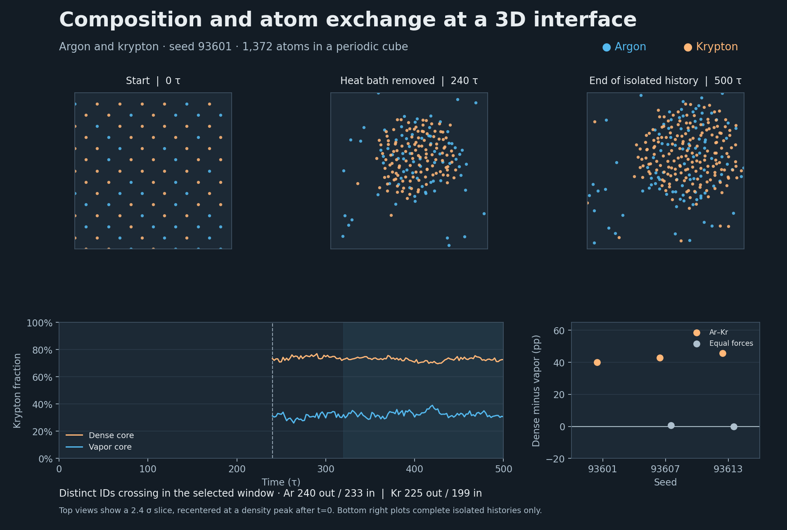

# 二成分の気液界面で測った組成差と原子の交換

2026-11-20。目的は、空間的に一様な始原状態から、同じ有限な濃い領域で内外の組成差と粒子の往復をどこまで同時に確認できるかを調べること。役割は F（同一の3D履歴で二成分を追跡）および V（測定器、局所対力、既存物性値との照合）。得た計算値は tier measured、材質・曲率・速度の一般化は frontier。R4に向けた受動的な気液界面の比較例として記録する。[研究の現在地](../../research/ladder.json)・[前回の単成分試験](2026-11-20-argon-interface-turnover.md)

## 事前登録と実行

計画、計算コード、主測定器、独立積分器を、混合物の計算前に GitHub のコミット `9902247bdd40af715316f2b8f44361db8af101a2` に固定した。単成分で使った接触グラフによる読み直しは、ジョブ開始後、混合物の履歴を開く前にコミット `1e299c99b8e4ea7e0f6f56cef3688e75798ed0b5` に固定した。幾何の主解析は登録どおり。物性とバルクの相平衡が既知であることを開示したうえで、粒子履歴との同時計測を検査した。[事前登録](../../research/campaigns/20261120-binary-boundary-exchange/PLAN.json)・[接触グラフを使う副解析](../../research/campaigns/20261120-binary-boundary-exchange/contacts.py)

箱は周期境界の立方体。初期位置は一様な面心立方格子、速度は質量に応じた Maxwell 分布を使い、重心速度を時刻0で引く。質量は Ar と Kr の文献値、Kr の数割合は0.60（標準箱では1,372個中823個）。成分の位置は別の乱数系列で全格子点に均一にシャッフルする。相は粒子の属性に含めない。標準箱の一辺は22.4σ、拡大箱では28.8σ、2,916原子。3つの新しい乱数種で Ar–Kr 対力と、全対力を Kr–Kr と等しくした古典対照を組にした。各組で質量、初期位置・速度、種別配置は一致する。最初の種で拡大箱と半分の時間刻みを試し、暖かい対照を1本追加した。

始めの熱浴は `T*=1.9`。時刻 $32\tau$ で冷却組の浴温を117.5 Kに切り替える。浴は原子ごとの確率 $1-e^{-0.30\,dt}$ で Maxwell 速度を当て直し、その運動エネルギー差を熱交換として記録する。時刻 $240\tau$ で位置と速度を複製し、片方の熱浴を外す。標準刻みは $0.004\tau$、細かい方は $0.002\tau$。全履歴の終端は $500\tau$。一様な熱浴と浴の切替を外部環境として明示し、局所の密度や組成を見て操作する経路を持たない。

対力は Miller らの単サイト Lennard–Jones パラメータを使用。Ar–Ar、Ar–Kr、Kr–Kr の順に `σ = 3.405, 3.519, 3.663 Å`、`ε = 1.654, 1.952, 2.305 × 10⁻²¹ J`。それぞれ自分の $3.5\sigma_{ij}$ で値と力が連続にゼロになるよう切る。$F=-U'$ として $U_{\rm fs}(r)=U(r)-U(r_c)+(r-r_c)F(r_c)$ を $r<r_c$ に使い、外側で力もポテンシャルもゼロにする。運動量を交換する力は対ごとに反対向き。力の計算と位置の保存は互いに独立。元論文の打ち切り法と今回の線形力シフトは異なる。多体効果、量子同位体効果、遠距離尾部を省いた、有効対力による法則 B の近似。[Miller らの Table I](https://doi.org/10.1063/1.4824140)・[計算コード](../../research/campaigns/20261120-binary-boundary-exchange/fluid.cpp)

## 測り方

成分ラベルを使わず、全粒子の総数密度を3D格子で平滑化する。主解析では密度 $0.35/\sigma^3$ 以上の最大連結成分について、体積 $80\sigma^3$ 以上で各軸に空の平面があるかを調べる。実座標を周期境界でつなぐので、箱の縁をまたぐ有限成分も読める。時刻240で成立した成分だけを、隣接時刻の重なる体積の比（Jaccard）0.5以上で追う。途中に切れ目があればそこで終了する。

表面から $2\sigma$ 以上奥の濃い側と、どの濃い領域からも $2\sigma$ 以上離れた薄い側を読む。時刻320〜500の各側に10原子以上ある観測から、クリプトン（Kr）の数を全原子数で割る。窓の全フレームを満たした場合を完全窓とし、時間を3つに割った値も保存する。同じ原子番号が両側でそれぞれ3コマ連続して確認され、両観測の実変位が $2\sigma$ 以上ある場合を出入りとして集計する。両端をこの窓内に限定したうえで、延べ件数と原子番号の重複を除いた個体数を分ける。滞在した粒子数・時間で割った件数は、測定上の核を使った経験値。温度、曲率、境界面積、界面に到達した母数を固定した透過係数はこの方法からは決まらない。

比較として密度閾値0.30・0.40、測る奥を $3\sigma$、観測間隔を $4\tau$ に変える。固定座標対照では分岐時の位置を動かさずに実際の動くマスクを当て、幾何の動きだけで所属が変わる数を測る。副解析では同じ時刻の座標から $1.8\sigma$ 以下の近隣を直接つなぎ、濃い側は近隣14個以上、薄い側は4個以下かつ濃い粒子から $2\sigma$ 以上の距離を条件にする。最大成分の原子番号の重なりで追跡する。[主測定](../../research/campaigns/20261120-binary-boundary-exchange/measure.py)・[近隣の幾何判定](../../research/campaigns/20261120-argon-interface-turnover/contact_check.py)

## 対力が等しいときの厳密な対照

両種の質量差を保ち、対力を同じにした古典モデルを考える。位置 $q$、運動量 $p$ のハミルトニアンは $H=\sum_i |p_i|^2/(2m_i)+U(q)$。全対力が共通なので $U(q)$ は原子番号の置換について対称である。正準分布で運動量を積分すると、`∏ᵢ (2πmᵢ/β)^(3/2)` は位置によらず、正規化した位置分布は $e^{-\beta U(q)}/Z_q$ となる。

孤立の場合も、エネルギー $E$ と全運動量 $P$ が一定のミクロカノニカル分布を置くと、質量でスケールした運動量空間のうち重心方向を固定した $3N-3$ 次元の球殻を積分する。位置分布は $E-U(q)-|P|^2/(2M)>0$ の領域で $[E-U(q)-|P|^2/(2M)]^{(3N-5)/2}$ に比例する。ここで $M=\sum_i m_i$。この場合も配置と種別の対応を変えて分布は変わらない。

したがってどちらの平衡分布でも、ラベルを読まずに選んだ相の奥に $n$ 原子あれば、Kr 数の期待値は $nN_{\rm Kr}/N$。同じ時刻の内外から求めた組成差の期待値は0。これは連続時間の**古典平衡模型**についての導出である。有限履歴が平衡を十分に巡るか、2種の速度や出入りの件数がどう違うか、実物の量子同位体効果があるかは別の測定になる。117.5 Kでの実物の同位体分別は微小だが測定されている。[実測の同位体分別](https://www.osti.gov/servlets/purl/7212128)

## 実物と比べる範囲

計画に固定した NIST WebBook の純成分飽和表2行ずつを $\log P$ と $1/T$ の間で内挿した。117.5 Kでアルゴン1.05363 MPa、クリプトン0.0847915 MPa、比は約12.43。理想混合・理想気体の仮定を加えると、液相での Kr 数割合 $x$ が与えられたとき、蒸気側は $y=x/[x+12.43(1-x)]$ となる。この比較は純物質の実験データを使った状態方程式と、理想混合の仮定から作った。混合物の直接測定値を代用した値ではない。既存の Ar–Kr 混合物測定には115.77 Kの全蒸気圧や、他温度の気液組成がある。ここでは同温度・同組成で照合できる実測表を使えていない。[Ar 飽和表](https://webbook.nist.gov/cgi/fluid.cgi?ID=C7440371&Action=Page)・[Kr 飽和表](https://webbook.nist.gov/cgi/fluid.cgi?ID=C7439909&Action=Page)・[混合物の蒸気圧測定](https://doi.org/10.1039/TF9676300855)・[混合物の気液組成測定](https://www.sciencedirect.com/science/article/pii/0378437175900424)

## 主解析の結果

計画した17本をすべて時刻500まで計算し、8つの共通前史を含む25ファイルを保存した。尺度は $\tau=2.15644$ ps。主解析で標準の Ar–Kr は6/6本が追跡と完全窓の条件を満たし、各本で両成分の両方向の移動を記録した。3つの孤立枝では、外部との熱交換が止まった後の約0.39 nsの観測窓で、濃い側の Kr が72.5〜74.1%、薄い側が28.5〜32.6%。組成差は40.1〜45.6パーセントポイントで、60τずつのどの区間でも符号は変わらなかった。熱浴を続けた3本の差は44.2〜48.3ポイント。孤立後の平均温度はおよそ117.6〜123.7 Kで、浴を続けた枝との比較にはその温度差も含まれる。

対力をそろえた古典対照では、完全に観測できた5/6本の差は −5.0〜+1.5ポイント。各乱数種で対応する浴ありの差を引くと、Ar–Kr 側が43.5、51.7、46.8ポイント上回った。孤立枝では完全な比較が成立した2組で42.3、45.8ポイント上回った。残る1組の対照は時刻322に追跡条件を失った。初期状態の一致は種別を含めて確認した。この変更は対力の強さ、距離尺度、気液量、冷却後の経路にも影響する。個別の力パラメータへの寄与の分解は行っていない。

表の「出／入」は、窓内で濃い側を出た番号と入った番号の種類数。各方向で重複を除いており、同じ原子が両方の列に入ることがある。対照93601の孤立枝で1コマだけ得た組成は括弧に示す。窓の比較には使わない。

| 条件と乱数種 | 枝 | 追跡最終時刻 τ | 有効コマ／91 | Kr 濃い／薄い % | Ar 出／入 | Kr 出／入 |
|---|---|---:|---:|---:|---:|---:|
| Ar–Kr 93601 | 浴 | 500 | 91 | 71.28／27.08 | 170／171 | 108／115 |
| Ar–Kr 93601 | 孤立 | 500 | 91 | 72.71／32.60 | 240／233 | 225／199 |
| Ar–Kr 93607 | 浴 | 500 | 91 | 72.87／26.12 | 205／210 | 120／139 |
| Ar–Kr 93607 | 孤立 | 500 | 91 | 72.48／29.63 | 218／213 | 168／179 |
| Ar–Kr 93613 | 浴 | 500 | 91 | 73.98／25.68 | 196／182 | 113／120 |
| Ar–Kr 93613 | 孤立 | 500 | 91 | 74.07／28.46 | 223／220 | 145／146 |
| 対力同一 93601 | 浴 | 500 | 91 | 60.51／59.77 | 49／56 | 56／63 |
| 対力同一 93601 | 孤立 | 320 | 1 | （58.56／62.30） | 0／0 | 0／0 |
| 対力同一 93607 | 浴 | 500 | 91 | 58.59／63.55 | 62／57 | 98／115 |
| 対力同一 93607 | 孤立 | 500 | 91 | 60.89／60.32 | 68／85 | 114／114 |
| 対力同一 93613 | 浴 | 500 | 91 | 59.94／58.40 | 75／78 | 98／87 |
| 対力同一 93613 | 孤立 | 500 | 91 | 60.56／60.74 | 99／87 | 101／98 |
| 拡大箱 93601 | 浴 | — | 0 | — | — | — |
| 拡大箱 93601 | 孤立 | — | 0 | — | — | — |
| 半刻み 93601 | 浴 | — | 0 | — | — | — |
| 半刻み 93601 | 孤立 | — | 0 | — | — | — |
| 暖対照 93601 | 浴 | — | 0 | — | — | — |

標準の孤立3本で、濃い側にいる原子・時間を分母に取った出る頻度は Ar 10.29〜11.82、Kr 2.32〜4.00 件／1,000原子τ。薄い側にいる原子・時間を分母に取った入る頻度は Ar 8.93〜9.56、Kr 15.26〜17.63。濃い液の内側から蒸気へかけて選んだ核同士の移動率なので、周囲の密度と拡散、滞在条件、追跡した形状も影響する。位置を固定した副読出しでは図の履歴に61件の見かけの出発があった。実変位を要求すると0件になった。[全試行・全読出しの値](../../research/campaigns/20261120-binary-boundary-exchange/analysis/results.json)



## 追跡が成立しなかった条件

標準 Ar–Kr の6本で、密度閾値0.35を0.30に下げると窓がそろったのは4本、0.40に上げると6本。奥を3σにする方法と4τ刻みでも6本。これらの完走例の組成差は39.3〜51.8ポイントで、いずれも両種の往復があった。格子を使わない接触グラフでは、種93607と93613の両枝で終端まで追跡でき、差は44.1〜49.0ポイント。図の種93601では浴ありの追跡が408τ、孤立が288τで切れた。拡大箱と半刻みの4本は主解析で分岐時に開始できなかった。補助の密度閾値0.40では、半刻みの孤立枝1本が完全窓で38.8ポイントと両種の往復を示す。刻みの変更は熱浴での乱数使用時刻も変える。この1組は軌道単位の収束検証にはならない。[近隣グラフの全結果](../../research/campaigns/20261120-binary-boundary-exchange/analysis/contacts.json)

主解析の結果を開いた後、追跡不能の時刻を同じ密度マスクで読み直した。周期境界を広げた座標で、領域の中の道を一周して元の点の隣の箱に達するかを判定する。拡大箱の240τでは **y 方向を一周する経路が実在**した。一方、半刻みの240τでは x の全平面に粒子領域が投影されるものの、一周する経路はなかった。対照93601の孤立枝が途切れた322τでも、z の全平面への投影が原因で、一周経路はなかった。空の平面を要求する従来の判定が、有限な領域を二例で除外していた。全平面を覆う有限な階段状成分、周期の継ぎ目を越える有限成分、箱を一周する成分を合成入力で区別した。既存の格子用検査と直接の経路走査で、保存した診断の値は一致した。この後解析では、追跡窓を延ばしたり主結果を書き換えたりしていない。[一周経路の診断値](../../research/campaigns/20261120-binary-boundary-exchange/analysis/winding.json)・[共用の周期境界検査](../../research/campaigns/20261119-transport-and-composition/observe.py)

暖対照では時刻0から500まで主解析で条件を満たす濃い領域を観測しなかった。これは今回の1本の結果。全体で有効な乱数種は標準箱の3つ。両枝、91コマ、数百回の移動、別の判定尺度を独立な反復に数えず、区間推定は行わない。

## 照合と誤差

浴を続けた標準3本で、薄い側の Kr は25.68〜27.08%。同じ濃い側の組成を理想式に代入すると16.65〜18.62%で、差は観測の方が7.06〜10.43ポイント大きかった。全体のビリアル圧は0.546〜0.587 MPa。曲がった境界のある有限箱全体での圧であり、実物のバルクの泡点圧とは対応を確立していない。理想混合からのずれ、曲率、観測の奥の選び方、切断した有効対力への帰属は未検証。

孤立8本の分岐後の熱交換は記録上すべて厳密に0。分岐からの全エネルギーの最大変化は1原子当たり $1.10\times10^{-4}\epsilon_{\rm Ar}$、全運動量は最大 $3.67\times10^{-12}\sqrt{m_{\rm Ar}\epsilon_{\rm Ar}}$。時刻0からの熱収支の最大残差は孤立枝を含め資料の ledger に示した。標準93601は同じ実行ファイルで時刻0から再実行し、前史・浴・孤立の3個の NPZ と分岐状態ハッシュが一致した。別の周期近傍木で分岐直後の2τを500ステップ積分し、全座標が保存された量子化区画に入ることを確認した。初期、分岐、分岐の1観測後のエネルギー・運動量・温度・圧力も一致した。異なる処理系での長時間のビット一致は未検証。[全時間の決定性](../../research/campaigns/20261120-binary-boundary-exchange/analysis/determinism.json)・[独立積分の結果](../../research/campaigns/20261120-binary-boundary-exchange/analysis/validation.json)

## 規律チェック

| 監査 | 確認 |
|---|---|
| `no_touch` | 今回の力・実行・測定・可視化は研究キャンペーンに追加した。既存の運動方程式と既存の研究機器のソースは変更なし。 |
| 第8監査 | 一様な位置、種別の総数、質量、温度と冷却時刻、周期境界、対力を与えた。界面・目標形状・相ごとの異なるルール・組成の目標値は力の入力に含めていない。測定器が粒子の運動や終了条件を変える経路はない。 |
| 3D | 構成粒子の位置と速度の3成分を時刻0から積分。濃度判定と局所連結は3D領域。図だけを2D断面にした。 |
| 全事例 | 初回はシステムの空き容量不足でコンパイラが起動後に一時ファイルを作れず、17件とも積分開始前に停止。別の一時領域で同じ登録入力を使い、全17件を計算完了。追跡不能も保存した。 |
| 外部照合 | 既存研究の Ar–Kr 尺度を採用。有効対力と有限箱の計算で組成差・粒子の出入りを観測。実物の混合組成と透過係数は照合未了。 |
| tier と段 | 実行・対照で得た数は F／V、tier measured。手法は近似 B。受動的な気液の分配と出入りを示した。膜としての選択的な透過、反応で支えられる維持、R4は未達。 |

## 再現手順

Python、NumPy 1.26.4、SciPy 1.15.3 と C++17 コンパイラを使用。可視化には matplotlib 3.10.8。使用環境、コンパイラのフラグ、実行ファイルと生データの SHA-256 は台帳に記載。リポジトリのルートから実行する。[登録済みの計画](../../research/campaigns/20261120-binary-boundary-exchange/PLAN.json)・[本試行台帳](../../research/campaigns/20261120-binary-boundary-exchange/evidence/record.json)・[最初の起動記録](../../research/campaigns/20261120-binary-boundary-exchange/evidence-first-launch/record.json)・[全履歴 ZIP](https://github.com/sunpotflower4460-cpu/Aeterna-Genesis/releases/tag/research-20261120-binary-boundary)

```sh
export PYTHONPATH=.
export OPENBLAS_NUM_THREADS=1
study=research/campaigns/20261120-binary-boundary-exchange
archive=research/campaigns/20261120-argon-interface-turnover/fetch_evidence.py
registered=9902247bdd40af715316f2b8f44361db8af101a2
python "$archive" --campaign "$study" --out /tmp/binary-evidence
python "$study/measure.py" --evidence /tmp/binary-evidence --out /tmp/binary-analysis
python "$study/contacts.py" --evidence /tmp/binary-evidence --out /tmp/binary-analysis/contacts.json
python "$study/winding.py" --evidence /tmp/binary-evidence --results /tmp/binary-analysis/results.json --out /tmp/binary-analysis/winding.json
python "$study/validate.py" --evidence /tmp/binary-evidence
python "$study/render.py" --evidence /tmp/binary-evidence --analysis /tmp/binary-analysis --out /tmp/binary-analysis/binary-exchange.png
python "$study/run.py" --registered-at "$registered" --scratch /tmp/binary-work --out /tmp/binary-replay
```

次に推奨するのは、空の平面を用いる読み方と一周経路を用いる読み方を両方事前に固定し、新しい乱数種と複数の箱で判定の差を測ること。実物との数値照合を優先する場合は、数値表から気液の組成が両方読める温度域を先に選び、層のある大きな箱と有限の塊の両方で測る。界面そのものの移動抵抗を調べるには、組成差を測るこの実験に加え、濃度・密度・温度を対応させた条件で外したときの緩和や通過確率を追う必要がある。
