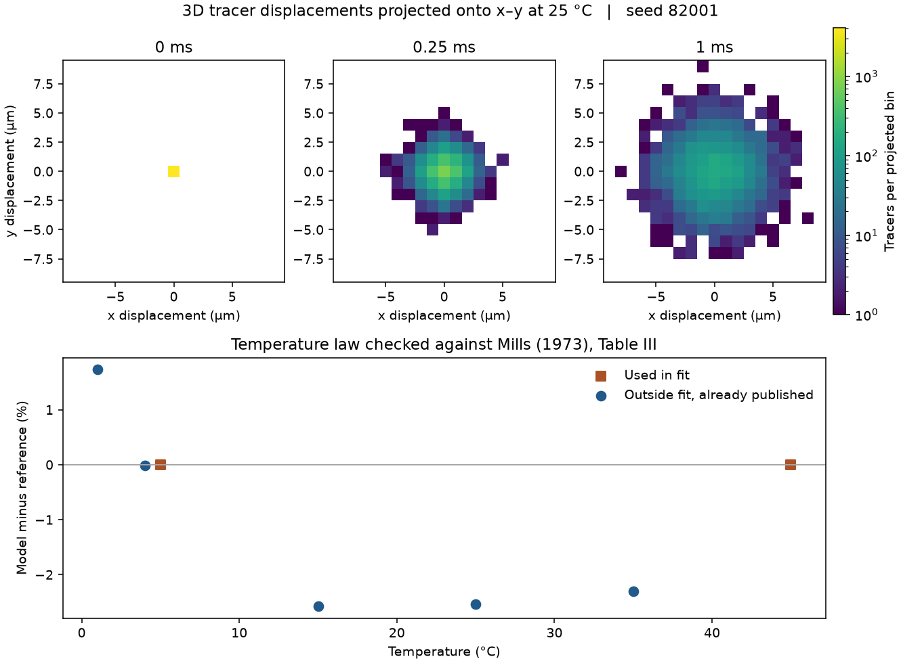

# 研究の前提と判定器の監査、水の拡散による照合

2026-11-20。今回の成果は測定基盤と輸送の検証（role V）、単純な温度近似の限界（role N）。物理モデル内の到達と生命のはしごの判断は個別に記録する。公式の現在地は R0 到達、R1 一部、R3 未達。[研究の前提](../STUDY_DESIGN.md)・[はしご](../LADDER.md)

## 測定器で確認した問題

水槽は「同じ宇宙で全部を同時に」と案内していた。従来は条件ごとの過去最長の持続時間を別々に検査し、全条件が一度ずつ成立すると達成扱いになった。条件Aがコマ0〜2、条件Bがコマ3〜4でしか成立しない系列は具体的な反例になる。現在は各条件の持続時間を満たすコマ番号の共通部分を取り、最初の共通時刻を返す。欠測と非有限値は持続を切る。発散した試行では、発散前の各条件の読み取りと試行の失敗を残す。

一括探索では全レシピ・当時の判定条件・試行数を実行前に保存し、各試行が終了するごとに結果を書き出す。停止時には開始済みの作業を回収し、開始できなかった条件と例外も記録する。実行の途中で記録自体が切れたケースは結果未記録として読める。旧版の点数は過去の記録として読み、現在の同時成立には加えない。判定器は離散的な観測時刻に関するもの。観測間の連続的な成立の証拠は別に要る。[判定実装](../../tools/lab/goals.py)・[一括探索](../../tools/lab/sweep.py)・[反例のテスト](../../tests/test_lab_sweep.py)

## 証明した範囲

一辺の移動距離を `a`、各軸の正負それぞれに独立な単位時間あたりの移動率を `D/a²` とする。無限に広い立方格子、一定の温度、相互に独立なトレーサーが仮定である。ある軸の時刻 `t` での変位は `a(N₊−N₋)`。二つのポアソン変数の平均と分散はそれぞれ `Dt/a²` なので、変位の平均はゼロ、二乗平均は `2Dt`。三軸を足すと **E[|r(t)−r(0)|²] = 6Dt**。これはこの跳躍過程について全時刻で成り立つ。この証明で `D` は与えた量である。

プログラムは観測間隔ごとに正負の跳躍数をサンプリングする。一定率のこのモデルでは、観測時刻での変位の同時分布を正確にサンプルできる。区間内の各跳躍の時刻や順序は保存しない。溶媒の分子運動、発熱、反応、境界の形成はモデル化していない。1 µm は測定器を確かめる格子尺度である。[計画](../../research/campaigns/20261120-water-diffusion-reference/PLAN.json)・[実装](../../research/campaigns/20261120-water-diffusion-reference/run.py)

## 計算で照合した範囲

計画と計算器を GitHub に掲載した後で乱数を生成した。7温度と移動率ゼロの対照をすべて実行した。各条件4系列（82001、82007、82009、82013）、各系列4,096トレーサー。温度と seed の組で乱数列を分けた。3次元変位の原点から、0、0.25、0.50、0.75、1.00 ms の全座標が残る。静止対照の全座標はゼロ。独立に計算し直した全8ファイルが同一環境で SHA-256 まで一致した。再生は反復試行の分母に足していない。[固定時のコミット](https://github.com/sunpotflower4460-cpu/Aeterna-Genesis/commit/017ea2d21bbfd1166a5e45cfa5c32745609f6bbe)・[生データの台帳](../../research/campaigns/20261120-water-diffusion-reference/evidence/record.json)

25℃・1 ms の計算から得た `D` の平均は 2.26038 × 10⁻⁹ m²/s、指定された法則の解析値は 2.24058 × 10⁻⁹ m²/s。標本誤差の理論標準誤差は 0.01507 × 10⁻⁹ m²/s。計算に使った式は `SE² = [2D²/3 + a²D/(6t)]/n`。各軸で跳躍数の差の二次・四次キュムラントがどちらも `2Dt/a²` になることから導ける。ここで `n` はその温度の独立な16,384トレーサー。温度ごとの実物の測定誤差はこの式に含まれない。[全160行の系列別測定](../../research/campaigns/20261120-water-diffusion-reference/analysis/per-seed.csv)・[温度別の結果](../../research/campaigns/20261120-water-diffusion-reference/analysis/temperatures.csv)

## 物質に照合した範囲

Mills の表IIIにある純水の自己拡散係数は、著者が同位体の拡散実験から推定した値である。5℃と45℃の2点で、`ln D` を絶対温度の逆数の一次関数として校正した。残る5点すべてについて、観測時のサンプリング誤差が入らない温度式そのものの残差を示す。1℃と4℃は校正範囲の外にある。[Mills (1973), Table III, p. 687](https://fenix.ciencias.ulisboa.pt/downloadFile/2533412229372806/Mills1973.pdf)

| 温度 | 1℃ | 4℃ | 15℃ | 25℃ | 35℃ |
|---|---:|---:|---:|---:|---:|
| モデルと文献値の差（文献値に対する割合） | +1.733% | −0.016% | −2.579% | −2.541% | −2.304% |

全7点が設計時に公表済みで、作業者も閲覧した。照合は遡及的であり、同じ論文の値は測定系や推定法を共有している。Mills 自身も曲がりを報告している。実物の測定を新規に行ったという主張や、以前の反応格子の物質係数への換算は含まれない。出典は表IIIに概算の精度を与えるが、各行の個別標準誤差は示していない。ここで比較したのは有効な輸送係数の一側面である。



上段は事前指定した25℃・seed 82001の全トレーサー。色は同じ対数目盛で、各自の出発点からの変位を投影した区画ごとの個数。下段の橙は校正2点、青は適合に使わなかった5点。図の形状はどの判定にも入力していない。

## 再現

リポジトリ直下で実行する。保存時は Python 3.10.11、NumPy 1.26.4、PCG64。水槽とその試験は Python 3.11 を使用する。図の再描画にだけ matplotlib を使う。保存先には新しいディレクトリを選ぶ。

```sh
study=research/campaigns/20261120-water-diffusion-reference
reg=017ea2d21bbfd1166a5e45cfa5c32745609f6bbe
python -m tools.study_record "$study/PLAN.json" "$study/evidence/record.json"
work=$(mktemp -d)
python "$study/run.py" --registered-at "$reg" --out "$work/raw"
python "$study/analyze.py" --evidence "$work/raw" --out "$work/measurements" --figure
python -m pytest -q tests/test_study_record.py tests/test_lab_goals.py tests/test_lab_sweep.py
python tools/ladder.py --check
```

浅いクローンで登録コミットが手元にない場合は `git fetch --depth=1 origin "$reg"` で取得できる。台帳検査は計画・指定ソース・全条件・ファイルの一致を点検する。研究者が以前見た資料や、申告のない試行の有無は Git ハッシュから判定できない。

**規律。** no-touch は既存の物理ソルバー・公式 Room・過去の原データに適用し、今回の変更は測定器、記録、研究手順、新しい参照計算に置いた。第8監査では、移動距離・移動率・温度近似・出発状態が入力であることを開示した。数値上の変位と残差の tier は measured。有限回の観測から生命や脳の性質を推論する項目は設けていない。
