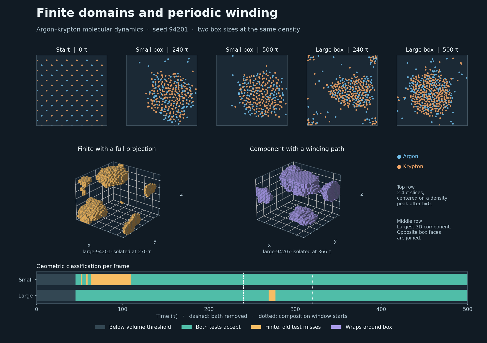

# 3D気液界面の周期境界判定を新しい履歴で検証

2026-11-20。前回、空の平面を各軸に求める判定が、周期箱を一周する経路のない濃い領域を除外した。今回は同じ3D密度と同じ原子座標で、空平面と一周経路による読み方を事前に固定し、新しい初期条件から比較する。役割は V（周期境界を読む計測器の検証）と F（有限領域での組成と移動を同時に計る範囲）。計算から直接読んだ数の tier は measured。実物の膜や、反応による維持への一般化は frontier。[前回の結果](2026-11-20-binary-boundary-exchange.md)・[研究の現在地](../../research/ladder.json)

## 事前登録と物理入力

GitHub の `519935a59f01bf20c3e7e4600577a7c163c33028` に、時刻、全条件、二つの観測法、検証コードを固定してから積分した。前回の解析で、全平面に広がって見える有限領域の2例と、実際に周期箱を一周する1例を確認済みだった。新規の4つの乱数種は標準数密度 $4/3.2^3=0.12207\, \sigma_{\rm Ar}^{-3}$ で、1,372原子、2,916原子の2サイズを交差させた。拡大側の最初の2種に、格子間隔を上下0.2σ動かした密度0.10177、0.14815を追加した。両サイズの格子間隔、初期種別総数比、冷却は同じ。箱の原子数が異なる条件では乱数種を対応させ、異なる位相空間の比較として読む。[実行前の計画](../../research/campaigns/20261120-periodic-boundary-confirmation/PLAN.json)

時刻0は一様な FCC 格子に、数で60%の Kr と40%の Ar を一様にシャッフルする。同じ原子数・乱数種で格子間隔を変えた場合、種別配列と初期速度が一致する。原子間は前回と同じ Ar–Ar、Ar–Kr、Kr–Kr の Lennard–Jones 対力。各対の3.5σで対力とポテンシャルを連続にゼロにする。物質の出入りはなく、位置・速度の3成分を $dt=0.004\tau$ で積分する。温度は時刻32τで熱浴の目標を117.5 Kへ変え、240τの同じ位置・速度から、熱浴が続く枝と孤立する枝を作る。暖対照は $T^*=1.9$ の浴を継続する。観測は2τ間隔、終点500τ。換算すると $\tau=2.15644$ ps。時刻と熱交換を外部環境として指定した。[対力の出典](https://doi.org/10.1063/1.4824140)・[共用した分子動力学コード](../../research/campaigns/20261120-binary-boundary-exchange/fluid.cpp)

## 何を周期箱で有限と読むか

原子種に依存せず、全数密度を3D格子で数え、周期的な Gaussian 幅1σで平滑化する。数密度0.35以上の面連結成分から、最大のものを選ぶ。体積の下限は80σ³。各軸方向に成分を含まない平面が1枚以上あれば、その成分の中の道で周期箱を一周できない。全平面に点がある場合は、一周経路があるか座標を検査する。どの軸にも一周経路がなければ、周期コピーを区別した無限格子上で、その連結成分を有限に展開できる。

判定の完全性は固定されたボクセルグラフ上で導ける。任意の頂点を根に選び、全域木で隣の点への整数変位を足し、各頂点の展開座標を割り当てる。木に入らない辺についても、辺の一歩で得る座標が割り当て済みの座標と一致すれば、任意の閉じた道では変位が打ち消し合う。不一致は箱の一辺の整数倍であり、その辺と木の経路を合わせた閉路に一周分以上の変位がある。今回の実装は箱の内側だけでつながる部分を縮約して境界越えを検査する。独立検査は縮約を省きボクセル間の一歩を直接たどる。分類は最大成分に限る。有限という結果から空洞の有無や界面が滑らかな閉曲面かは決まらない。[周期系での一周経路検出の先行研究](https://doi.org/10.1103/PhysRevE.64.016706)・[共用の周期連結コード](../../research/campaigns/20261119-transport-and-composition/observe.py)・[直接経路の検査](../../research/campaigns/20261120-periodic-boundary-confirmation/verify.py)

両方の読み方に同じ最大成分、初回240τ、隣接フレームの体積 Jaccard 0.5以上を使う。途中で条件を失った時は追跡を終える。窓320〜500τの全91コマで両側の奥に10原子以上があれば、組成を比較する完全窓とする。濃い側は成分の表面から2σ以上離れた点、薄い側は全ての濃い領域から2σ以上離れた点。Kr 数を全数で割り、粒子×時刻で集計する。同じIDが各側に3コマ連続して滞在し、窓内の両端で周期変位が2σ以上の時に移動として数える。固定座標に動く領域を当てた場合の見かけの移動も記録する。連続追跡を条件にせず、各時刻の有限領域や一周する領域でも、濃い側と薄い側の組成を同じ規則で読む。

密度閾値0.30・0.40と、0.35で全軸半ボクセル移動した格子も固定した。同じマスクを整数ボクセルだけ平行移動したときの一周判定は不変。原子の座標から格子へ写し直すとマスク自体が変わり、結果に感度が出る。分岐からの待ち時間と追跡の基準、成分の同一性を読む間隔も結果に影響する。コマ、枝、粒子、別の格子を独立な反復に数えず、標準条件の乱数種を比較の単位とする。密度上下の比較は2種のみ。[登録済みの観測コード](../../research/campaigns/20261120-periodic-boundary-confirmation/readouts.py)

## 全25履歴の観測

全履歴を時刻500τまで計算した。冷却した24本では42〜62τに初めて体積80σ³以上の濃い領域が現れた。暖対照の1本では終点までこの体積に達しなかった。

基準の読み方で、完全窓に両種の両方向の移動も記録できた履歴は **13/24本から19/24本** になった。浴を止めた枝に限ると6/12本から9/12本。新たに測れたのは小箱94213、低密度94201、高密度94207の3組から出た6本である。下表のコマは分岐時の共通状態を各枝に数えた、240τ以降の延べ集計。コマ数を反復数や確率には使わない。

| 条件 | 本数 | 空平面で完測 | 一周経路で完測 | 従来法が除いた有限コマ | 一周のあるコマ |
|---|---:|---:|---:|---:|---:|
| 小箱、標準密度 | 8 | 6 | 8 | 12 | 0 |
| 大箱、標準密度 | 8 | 5 | 5 | 6 | 68 |
| 大箱、低密度 | 4 | 2 | 4 | 34 | 0 |
| 大箱、高密度 | 4 | 0 | 2 | 38 | 262 |
| 冷却組計 | 24 | 13 | 19 | 90／3,144 | 330／3,144 |
| 大箱、暖対照 | 1 | 0 | 0 | 0 | 0 |

小箱94213の孤立枝は空平面の条件で248τに途切れた。一周経路で読むと500τまで追え、窓の組成は濃い側73.0%、薄い側33.5%。Arの出発232個・到着223個、Krの出発194個・到着240個を、方向ごとに番号の重複を除いて確認した。固定座標の副読出しでは232件の所属の変化があった。実変位を伴う移動は0件だった。完全窓19本の組成差は38.3〜48.8ポイント。孤立枝で完測した9本は38.3〜47.8ポイント。完全窓19本は、窓を60τずつ3区間に分けた全区間で符号を保った。

一周経路で5本が未完測だった。大箱94201の両枝、大箱94207の孤立枝は、濃い領域の隣接フレームでの重なりが足りなかった。大箱94207の孤立枝では362τで追跡条件を失い、366τからは一周経路が記録された。高密度94201の両枝は、開始時の240τから終点まで全131コマに一周経路があった。同じ高密度の94207は両枝を通して一周せず、空平面の条件に限って追跡開始ができなかった。この密度では2種しか実行しておらず、形の出現確率は測っていない。[全主解析値と全設定の感度](../../research/campaigns/20261120-periodic-boundary-confirmation/analysis/results.json)



## 組成差と一周経路

窓内で一周したコマにも、同じ奥行きで双方に10原子以上があり、3本の計250コマすべてで組成を読めた。大箱94207の孤立枝では一周した68コマで42.2ポイント、高密度94201の浴継続と孤立では各91コマでそれぞれ43.6、47.4ポイント。有限な成分の完全窓と同程度の内外差が、有限に展開できない濃い領域にもある。これらの組成は時刻ごとの成分の集計であり、一周中に同じ成分を連続追跡した証拠には使わない。

密度閾値0.30、0.40と半ボクセル平行移動でも、一周経路で完測した19本は同じだった。従来法で完測できた本数は順に13、15、13本。従来法が除外した有限成分の延べコマ数は61〜125コマの範囲で変わった。固定されたマスク上で一周があるかは決定できる。連続密度のどこを成分に含めるかは粗視化に依存する。周期的な有限箱で濃い領域の形が密度に応じて変わることは単成分流体の先行研究にある。ここで観測した二成分の有限時間の形から、平衡の形の転移点や箱サイズの極限は求めていない。[周期箱での形の先行研究](https://arxiv.org/abs/1509.02324)

## 再現と監査

前回保存した4本で、従来法の追跡終点、有効コマ数、移動集計が保存値と一致することを事前の機器確認に使った。一周経路による判定を適用すると、旧実験の半刻みの孤立枝は240τから500τまで追えた。等しい対力の種93601の孤立枝も320τから500τまで追跡が延びた。実際に一周した旧実験の拡大箱の孤立枝は、どちらの方法も240τに追跡を始められなかった。この4本は今回の25本に含めていない。[前回の公開履歴](https://github.com/sunpotflower4460-cpu/Aeterna-Genesis/releases/tag/research-20261120-binary-boundary)

合成した周期管、周期の継ぎ目をまたぐ有限成分、全x平面を覆う有限な階段状成分、2軸を一周する成分を使い、平行移動の前後で一周軸と空平面判定を検査した。[検証コード](../../research/campaigns/20261120-periodic-boundary-confirmation/verify.py)

新しい履歴の11コマは、縮約しない独立な経路検査で一周軸が一致した。登録した大小各1本について、旧観測器の終点、完全窓、組成と移動集計も再現した。今回の大箱94201の孤立枝では、別の周期近傍木で240τから500ステップを積分し、全座標が保存された量子化区画内に入った。孤立12本の熱交換はすべて厳密に0で、分岐後のエネルギー変動は最大で1原子当たり約 $1.02\times10^{-4}\epsilon_{\rm Ar}$、運動量変動は最大約 $4.75\times10^{-12}\sqrt{m_{\rm Ar}\epsilon_{\rm Ar}}$。[独立検査の結果](../../research/campaigns/20261120-periodic-boundary-confirmation/analysis/validation.json)・[時刻0からの再実行の一致](../../research/campaigns/20261120-periodic-boundary-confirmation/analysis/determinism.json)

| 監査 | 確認 |
|---|---|
| `no_touch` | 観測器をキャンペーンに追加。既存の力、積分器、初期状態、旧観測器はバイトを固定して再使用した。 |
| 第8監査 | 入力は粒子の位置・速度と種類、箱、事前に指定した温度と熱交換、対力。初期時刻に目標形状や成分ごとの領域、持続や分裂を起こす規則を入れていない。密度、形、組成、移動判定は積分後に読み取った。 |
| 3D | 位置・速度・局所力・連結性のいずれも3軸。断面とボクセル図は保存座標の可視化。 |
| 全事例 | 全25履歴と12組の共通前史を保存。空平面・一周・体積・重なり、組成の有効コマと部分窓も残した。 |
| 決定性 | 小箱94201を同じ実行バイナリで時刻0から再計算し、前史・継続浴・孤立の3つのNPZと分岐ハッシュを照合。異なる処理系の長時間ビット一致は未検証。 |
| tier と限界 | 数値は measured。役割 V／F。相互作用は有効対ポテンシャルを使った近似 B。実験と同条件の混合物の気液組成、膜としての透過、反応に支えられた維持は未検証。 |

Python 3.10.11、NumPy 1.26.4、SciPy 1.15.3、C++17 を使用。図には matplotlib 3.10.8。環境、ビルドフラグ、全データの SHA-256 を記録した。リポジトリのルートから以下を実行する。最初の3つの Python コマンドで取得・主解析・検証ができる。[本試行台帳](../../research/campaigns/20261120-periodic-boundary-confirmation/evidence/record.json)・[アーカイブのハッシュ](../../research/campaigns/20261120-periodic-boundary-confirmation/ARCHIVE.json)・[25本の原座標・詳細な読出し](https://github.com/sunpotflower4460-cpu/Aeterna-Genesis/releases/tag/research-20261120-periodic-boundaries)

```sh
export PYTHONPATH=.
export OPENBLAS_NUM_THREADS=1
study=research/campaigns/20261120-periodic-boundary-confirmation
fetcher=research/campaigns/20261120-argon-interface-turnover/fetch_evidence.py
registered=519935a59f01bf20c3e7e4600577a7c163c33028
python "$fetcher" --campaign "$study" --out /tmp/periodic-evidence
python "$study/readouts.py" --evidence /tmp/periodic-evidence --out /tmp/periodic-analysis
python "$study/verify.py" --evidence /tmp/periodic-evidence --analysis /tmp/periodic-analysis --out /tmp/periodic-analysis/validation.json
python "$study/plot.py" --evidence /tmp/periodic-evidence --analysis /tmp/periodic-analysis --out /tmp/periodic-analysis/periodic-boundaries.png
python "$study/study.py" --registered-at "$registered" --scratch /tmp/periodic-work --out /tmp/periodic-replay
```

次の確認には、格子に分ける前の原子座標で近隣のグラフをつくり、その近隣をたどる一周経路と時間上の重なりを測る方法を推奨する。密度の読み方と成分の同一性の両方に依存する残り3本の追跡切れを検証できる。実物への定量照合を先に進める場合は、気相と液相の組成が揃う実測条件を入手し、既知の相分配を基準としてから粒子の出入りと界面の効果を測る。[Ar–Kr 気液組成の実験](https://doi.org/10.1016/0378-4371(75)90042-4)
