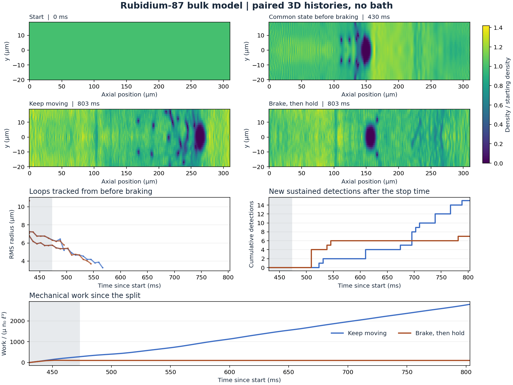
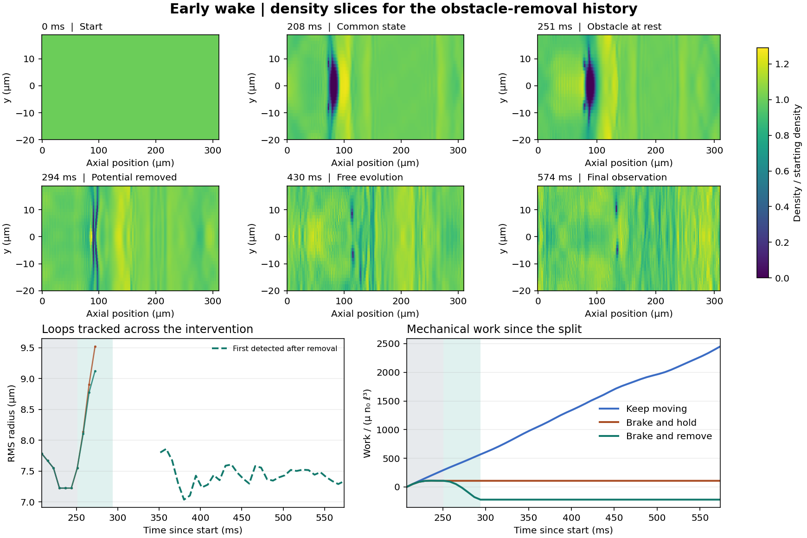
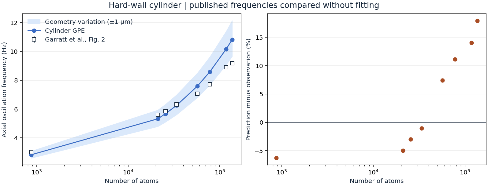

# 超流体の渦は、外からの仕事を止めた後も続くか

2026-11-20。はしご R1「食べて形を保つ」の対照。流れで構造が生まれることと、できた構造を保つのに流れが必要であることを調べた。今回の役割は、過去の解釈を確かめる介入試験（F）と、測定器・物理模型の妥当性確認（V）。計算から得た数値は tier measured。R1 の到達判定は研究台帳に記す。[研究の台帳](../../research/ladder.json)

## 実験の前提

ルビジウム87の希薄凝縮体の平均場方程式を用いた。Garratt らの円筒で使われた原子数 \(1.2\times10^5\)、長さ26 µm、半径16 µmから平均密度 \(n_0=5.74\times10^{18}\,\mathrm{m}^{-3}\) を求めた。散乱長は論文の近似 \(a=100a_0\) で、\(g=4\pi\hbar^2a/m,\ \mu=gn_0\)。バルクの換算単位は長さ \(\ell=\hbar/\sqrt{m\mu}=1.619\) µm、標準的な回復長は \(\xi=\ell/\sqrt{2}=1.145\) µm、時間 \(\tau=\hbar/\mu=3.586\) ms、音速 \(c=0.4514\) mm/s。\(n_0a^3=8.50\times10^{-7}\)。原子数と装置寸法は単位の根拠であり、渦を追う周期領域は論文の円筒とは異なる。[Garratt et al.](https://arxiv.org/pdf/1810.08195)・[NIST 同位体質量](https://physics.nist.gov/cgi-bin/Compositions/stand_alone.pl?ele=Rb)・[CODATA](https://physics.nist.gov/cuu/pdf/RevModPhys.97.025002.pdf)

3D の時刻0は一様な密度で、種から引いた微小な位相揺らぎを加える。最初の渦は置かない。ガウス障害物を \(\sigma=2.5\ell\)、高さ \(5\mu\) まで静止したまま立ち上げて、動かす腕では \(0.68c\) まで加速する。波が箱の端を越えて戻る周期領域である。基本の物理寸法は \(24\ell\times24\ell\times192\ell\)、拡大条件は \(36\ell\times36\ell\times240\ell\)。格子幅は \(0.75\ell\) と \(0.5\ell\)。ガウスの大きさ・経路・時刻は指定した装置条件。有限の箱、近似された相互作用、熱成分を省いた極限が解釈の範囲を決める。過去の P12 から引き継いだ \(\gamma=0.01\) の浴は感度比較で、ルビジウムの測定からは決めていない。浴を入れない計算は \(\gamma=0\)。[固定した計画](../../research/campaigns/20261120-vortex-drive-stop/PLAN.json)・[過去の P12](2026-09-26-p12-torus-feed.md)・[先行する球状障害物の計算](https://arxiv.org/abs/cond-mat/0006125)

## 何を輪と数えたか

格子の各面を一周した複素場の位相差を保存し、\(2\pi\) の巻きが面を貫くとき、向き付きの渦線を置くのは測定側だけである。隣接する面の貫通から3Dの連結成分を作る。入出がともに1本ずつで、周期境界を展開したとき閉じる成分を測る。重心からの二乗平均半径が \(2\ell\) 以上、貫通点の障害物ポテンシャルが \(0.5\mu\) 以下を主条件とした。各観測間で重心と半径の対応先が互いに一つに定まるときに追跡を続ける。別成分との合流や接近、太さの閾値への到達で同一性を判定できなくなることがある。3コマ以上リンクした新しい追跡の開始を計数するので、再検出も含みうる。箱を一周する渦線・分岐して対応不能な成分は別件数を残す。[追跡のコード](../../research/campaigns/20261120-vortex-drive-stop/loops.py)・[位相の生データと台帳](../../research/campaigns/20261120-vortex-drive-stop/evidence/record.json)

この手順で、境界をまたいだ合成の閉ループを正しい位置に再構成し、箱全体を巻く線は別扱いになった。実際の複素場から既存の NumPy の巻き数計算で独立に再読した3状態は、符号を含め304、764、180の面ですべて一致した。密度断面も保存精度で一致した。合成場は測定器専用で、渦の実験には入力していない。[測定器の照合](../../research/campaigns/20261120-vortex-drive-stop/crosscheck.py)・[照合結果](../../research/campaigns/20261120-vortex-drive-stop/analysis/crosscheck.json)

## 渦が複数できてから止めた26履歴

12組は片方が動き続け、片方が \(t=120\tau\) から12時間単位をかけて減速し、その位置で静止する。各腕は時刻0から独立に計算し、同じ組では時刻120までの複素場の SHA-256、台帳、位相の記録が一致した。残る2本は最初から静止の対照である。いずれの時刻0にも検出はなく、静止対照2本にも主条件の輪は出なかった。[^1] 持続を比較した停止後の窓は \(132\le t/\tau\le224\)、約330 ms。

- 新しい追跡の開始件数は12組すべてで止めた側が少なかった。基本格子の6組では継続側9〜15件、停止側3〜7件。箱・時間刻み・空間刻みを変えた組も同じ向きで、ポテンシャルの閾値を0.25・1.0へ変えた読み取りと、観測を4時間単位おきにした読み取りでも同じ向きだった。
- 減速前の3コマですでに追跡していた基本格子の計17件は、継続・停止の両方で \(t=176\tau\) までに連続した対応が途切れた。拡大した箱では、停止側にも \(t=224\tau\) まで追えたものが出た。有限時間内の連続追跡は、複数の構造の接近や箱の影響を受ける。計数の差を一つの輪の寿命に読み替える根拠は得ていない。
- 停止側の仕事率は \(t=132\tau\) 以降すべて厳密に0。既に波や流れに蓄えられていたエネルギーは残る。粗い時間刻みでは、浴なしの台帳の最大残差が各履歴の最大の自由エネルギーに対して最大5.34%。刻みを半減した4履歴は最大0.38%、さらに格子を細かくした4履歴は最大0.081%だった。

[^1]: 最初から静止の対照でも、障害物の高さを立ち上げる間は外から仕事が入る。静止と呼ぶのは位置である。



## 渦が少ない時点で止める追試

最初の輪が現れる時期を上の基本格子の測定から読み、次の事前登録で減速開始を \(t=58\tau\) に定めた。浴なしに絞り、近接ラプラシアンの固有値を使った分割法で時間積分をやり直した。固定した時刻に12時間単位をかけて減速して保持する腕と、さらに12時間単位をかけて静止ポテンシャル自体を消す腕を比べる。基本格子3種には動かし続ける腕もある。減速中やポテンシャルを消す間の仕事は符号付きで記録する。[追試の計画](../../research/campaigns/20261120-vortex-early-stop/PLAN.json)

最初に各腕を独立に再計算したところ、基本格子3種の初期複素場のハッシュは組内で同じでも、時刻58の複素場ハッシュが一致しなかった。時刻58以前の基本格子の巻きと断面は一致し、グローバルな自由エネルギーの差は最大 \(1.1\times10^{-11}\) 計算単位だった。場全体の点ごとの差とビット差の由来は確定していない。比較プログラムは登録どおり停止した。全履歴を保存し、結果を足し合わせずに共通状態を一つだけ計算する手順を登録した。時刻58までは各解像度・種で共通に積分し、保持と消去の腕は減速が終わる時刻70まで共有する。場の値は選別・加工せずそのまま引き継ぐ。[照合に失敗した15履歴](../../research/campaigns/20261120-vortex-early-stop/evidence-first-attempt/record.json)・[同一状態から再実行する固定計画](../../research/campaigns/20261120-vortex-early-stop/PAIRED_PLAN.json)

共通状態からの再実行では、基本格子の3種すべてで、時刻58まで追えた輪は一つだった。動かし続けた場合の最後の対応は時刻66、停止して保持・消去へ進んだ場合は時刻76だった。この履歴で、停止が既存の輪の寿命を短くするような結果は出なかった。消去後の3本では、最初に時刻96〜98で対応が始まった別の追跡を時刻160まで続けられた。これは障害物も仕事もない区間で、繰り返し得た継続時間の下限が約222〜230 msに達したことを示す。追跡の開始は物理的な誕生の確定時刻を与えない。消去時の仕事は基本格子で約−329計算単位であり、消去完了時に波や流れなどを含む全場には約1,017〜1,018計算単位の自由エネルギーが残っていた。

| 消去した条件 | 減速前の輪を最後に対応づけた時刻 | 消去後に始まり、末尾の時刻160まで続いた追跡の開始 |
| --- | ---: | --- |
| 基本格子、種92301、92307、92311 | 各76 | 98、96、96 |
| 種92301、時間刻みを半分 | 76 | 98 |
| 種92301、同じ小さい時間刻みで格子を細かくする | 80 | 86、154 |
| 種92301、箱を拡大 | 60 | 該当なし |

表は2時間単位おきの主観測。格子を細かくした条件は4時間単位おきの読み直しで追跡の開始・終了が変わった。拡大箱では、消去後に3コマ以上続く新たな追跡も0件だった。15本で質量ノルムの最大相対変動は \(3.85\times10^{-13}\) 未満、エネルギー台帳の最大残差は最大エネルギー比で0.047%未満。箱の幅と長さを同時に変えたので、どの境界方向の影響かは特定できない。R1 の到達は一部のままとする。[15履歴の照合と全測定](../../research/campaigns/20261120-vortex-early-stop/analysis/results.json)・[最初の実行の照合診断](../../research/campaigns/20261120-vortex-early-stop/evidence-first-attempt/prefix-audit.json)



## ルビジウムの実測値との照合

Garratt らの原図2の対数目盛を読み取り、左端の孤立した1点と右端側の孤立した7点を採った。画素座標と換算式は登録計画に残した。円筒の硬い壁と軸上の正則性を使い、軸対称の定常状態を密度から求める。次に軸方向の奇対称な最低モードを、有限体積の空間離散化と Bogoliubov 線形化から計算した。周波数は係数に使っていない。測定マーカーの読取り幅を2 px とし、これは約0.67%の周波数幅に相当する。半径・長さ各±1 µm の変動も計算した。マーカーの横方向の原子数誤差や実験全体の体系誤差は、この幅には含まれない。[論文と原図2](https://arxiv.org/pdf/1810.08195)・[円筒の予測結果](../../research/campaigns/20261120-vortex-drive-stop/analysis/results.json)

| 読み取り原子数 | 文献の周波数 Hz | 0.25 µm計算 Hz | 相対差 |
| ---: | ---: | ---: | ---: |
| 872 | 3.014 | 2.824 | −6.30% |
| 21,020 | 5.600 | 5.323 | −4.95% |
| 25,487 | 5.849 | 5.674 | −3.00% |
| 33,702 | 6.318 | 6.252 | −1.04% |
| 56,885 | 7.068 | 7.594 | +7.44% |
| 77,675 | 7.724 | 8.584 | +11.14% |
| 117,544 | 8.920 | 10.173 | +14.05% |
| 136,256 | 9.177 | 10.825 | +17.95% |

0.5 µm から 0.25 µm へ細かくした差は最大0.22%。別に導出したベッセル関数と軸の固有関数による計算では低密度点2.8255 Hz、高密度点10.8432 Hzで、有限体積との差は各0.04%、0.17%だった。高密度側の2点の差は、今回の幾何寸法±1 µmの四隅の計算でも残った。散乱長や密度を周波数に合わせて調整していない。計算同士が近いことを確認しても、実物のずれの原因や渦の寿命の精度は定まらない。[独立の固有値計算](../../research/campaigns/20261120-vortex-drive-stop/analysis/crosscheck.json)



## エネルギーと計算の再現

無次元化した局所格子の汎関数を \(E_h=h^3\sum(\tfrac12|\nabla_h\psi|^2+\tfrac12(|\psi|^2-1)^2+V|\psi|^2)\) とする。周期境界では、離散の部分和公式からその勾配 \(F=-\tfrac12\Delta_h\psi+(|\psi|^2-1+V)\psi\) が得られる。正確な半離散方程式 \(\dot\psi=-(i+\gamma)F\) では \(\dot E_h=h^3\sum|\psi|^2\dot V-2\gamma h^3\sum|F|^2\)。第1項が障害物からの仕事率、第2項は仮の浴による自由エネルギーの減少で、実際に測った熱ではない。浴なし・一定の \(V\) では、連続時間の格子方程式のノルムと \(E_h\) が保存する。有限時間刻みの残差は台帳で比較できる。

**規律。** no-touch として既存の物理ソルバー、Room、前の実験の生データを改変していない。第8監査では、初期の位相揺らぎ、凝縮体、障害物、動かし方、選んだ観測時間を入力として明記した。輪の検出・追跡・分岐の計数は測定側で、場の更新から参照しない。外部介入を含む対照の履歴を、創発の正式 Room には数えない。既存の C++ 計算のうち基本格子の浴なし第1組は、同じ実行ファイル・環境で時刻0から再計算してすべての出力ファイルの SHA-256 が一致した。環境をまたいだ全時間の浮動小数点のビット一致は未確認。時刻58の修正は、FFT が同じ状態を独立に再生成することへの依存を取り除く。

以下はリポジトリ直下から実行できる。登録時点を含む Git 履歴と Python、NumPy 1.26.4、SciPy 1.15.3、C++17 コンパイラが必要。図の描画には matplotlib を使う。3Dの実行は計算機に応じて数分以上かかる。

```sh
late=research/campaigns/20261120-vortex-drive-stop
early=research/campaigns/20261120-vortex-early-stop
export PYTHONPATH=.
export OMP_NUM_THREADS=1 OPENBLAS_NUM_THREADS=1
work=$(mktemp -d)
python -m tools.study_record "$late/PLAN.json" "$late/evidence/record.json"
python -m tools.study_record "$early/PLAN.json" "$early/evidence-first-attempt/record.json"
python -m tools.study_record "$early/PAIRED_PLAN.json" "$early/evidence/record.json"
python "$late/analyze.py" --evidence "$late/evidence" --out "$work/late-measurements"
python "$early/paired_analysis.py" --evidence "$early/evidence" --out "$work/early-measurements"
python "$late/crosscheck.py" --evidence "$late/evidence"

python "$late/run.py" --registered-at 811bb343025e1bdb58c83afeb66f4dc8d87a9d67 \
  --scratch "$work/late-scratch" --out "$work/late-replay"
python "$early/paired_run.py" --registered-at e247db603f534dc5b192d5ab26760741271ad54c \
  --out "$work/early-replay"
```

[遅い停止の数値と全追跡](../../research/campaigns/20261120-vortex-drive-stop/analysis/results.json)・[早い停止の数値と全追跡](../../research/campaigns/20261120-vortex-early-stop/analysis/results.json)
